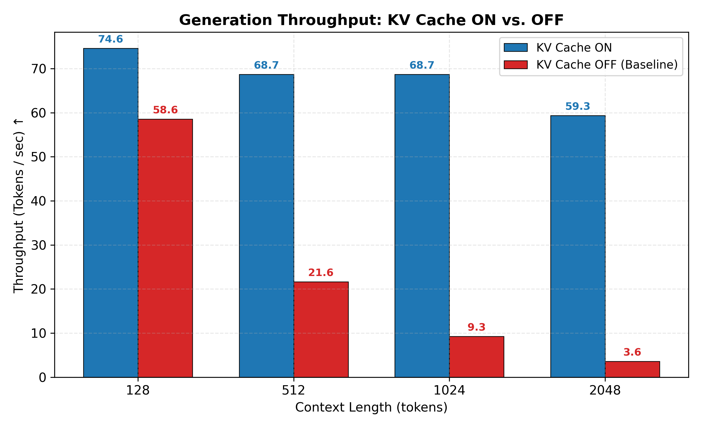
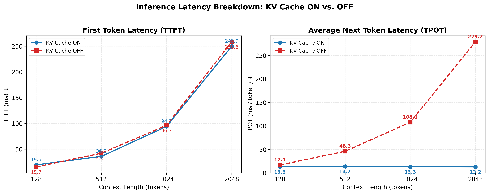
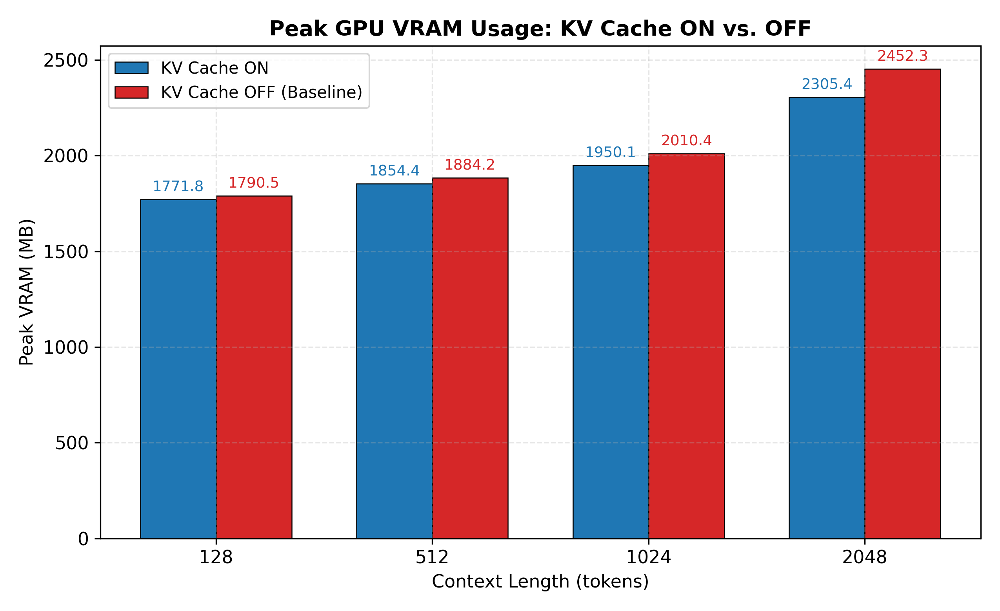

# Capstone Project: Building, Optimizing, and Aligning a 109.5M LLM from Scratch (Track B: Alignment & Safety)

Dự án xây dựng hoàn chỉnh một Mô hình Ngôn ngữ Lớn (LLM) quy mô **109.5M tham số** (`109,529,856` params, GPT-2 Small scale) từ đầu bằng PyTorch thuần trong thư mục [`capstone-llm/`](capstone-llm/) — bao gồm BPE Tokenizer 32k, Transformer Decoder (RMSNorm, RoPE, SwiGLU, Weight Tying), Pre-training trên Kaggle Dual T4 GPUs, Post-training (**Full Fine-Tuning**, **LoRA + Embedding SFT**, **DPO Alignment**), tối ưu suy luận **Static KV Cache**, hệ thống **Input/Output Guardrails 2 tầng**, **LLM-as-a-Judge**, **Error Analysis**, và **Gradio Demo**.

---

## 1. Kiến trúc Mô hình 109.5M

- **Tổng số tham số (Weight-Tied)**: `109,529,856` (~109.5M)
- **Tokenizer**: Byte-Pair Encoding (BPE) `vocab_size = 32,000`, `pre_tokenizers.Sequence([Whitespace(), Digits(individual_digits=True)])`
- **Cấu hình Transformer**: `d_model = 768`, `n_layers = 12`, `n_heads = 12` (`head_dim = 64`), `d_ff = 2048` (SwiGLU), Pre-RMSNorm (`eps = 1e-6`), RoPE (mở rộng động $\ge 2200$ vị trí)
- **Tối ưu suy luận**: Static Pre-allocated `KVCache`, Top-p (`0.9`), Repetition Penalty (`1.2`)

---

## 2. Hướng dẫn Cài đặt & Chạy Tái lập (One-Click Run)

```bash
cd capstone-llm
pip install torch tokenizers datasets gradio matplotlib pytest kaggle

# 1. Chạy toàn bộ Unit Tests (17/17 tests)
pytest tests/ -v

# 2. Chạy trọn bộ pipeline trên Kaggle (Tokenizer -> Pretrain -> SFT -> DPO -> Eval)
python run_all_kaggle.py --batch_size 4 --grad_accum 16 --pretrain_steps 5000 --sft_epochs 3 --dpo_steps 1000

# 3. Huấn luyện SFT (LoRA+Embed vs Full Fine-Tuning)
python training/train_sft.py --epochs 3 --lr 2e-4
python training/train_sft.py --full_ft --epochs 3 --lr 2e-4

# 4. Đánh giá Lõi, KV Cache Profiling, Guardrails & LLM-as-a-Judge
python eval/evaluate.py --save_samples --out_dir day2_reports/eval_core
python eval/profile_kv_cache.py --out_dir day2_reports/kv_cache
python eval/eval_guardrails.py --out_dir day2_reports/guardrails
python eval/llm_judge.py --generate_only --out_dir day2_reports/llm_judge
GEMINI_API_KEY="YOUR_KEY" python eval/llm_judge.py --judge --out_dir day2_reports/llm_judge

# 5. Khởi chạy Gradio Interactive Demo
python app.py --port 7860
```

---

## 3. Tổng hợp Kết quả Thực nghiệm Chính thức

### 3.1. Đánh giá Định lượng Lõi (`Base` vs `SFT Full FT` vs `SFT LoRA+Embed` vs `DPO Step 200`)

| Model Variant | Validation PPL (↓) | Math Pass@1 (%) (↑) | Safety Refusal Rate (%) (↑) |
|---|---:|---:|---:|
| Base (100M) | **2.84** | 0.0 | 100.0 |
| SFT (Full Fine-Tuning) | 3.19 | 0.0 | 100.0 |
| SFT (Instruct + Math) | 3.19 | 0.0 | 100.0 |
| DPO (Aligned + Safe — Step 200) | 3.24 | 0.0 | 100.0 |

### 3.2. KV Cache Profiling (Context Length 128–2048, CUDA GPU)

| Context Length (L) | Mode | Throughput (tok/s) ↑ | TTFT (ms) ↓ | TPOT (ms/tok) ↓ | Peak VRAM (MB) | Speedup |
|---:|---|---:|---:|---:|---:|---:|
| 128 | **KV Cache ON** | **74.58** | 19.63 | **13.31** | **1771.81** | **1.27x** |
| 128 | KV Cache OFF | 58.57 | 15.70 | 17.09 | 1790.50 | 1.00x |
| 512 | **KV Cache ON** | **68.71** | **36.01** | **14.21** | **1854.44** | **3.18x** |
| 512 | KV Cache OFF | 21.63 | 42.12 | 46.29 | 1884.20 | 1.00x |
| 1024 | **KV Cache ON** | **68.67** | **94.18** | **13.30** | **1950.07** | **7.41x** |
| 1024 | KV Cache OFF | 9.27 | 96.33 | 108.06 | 2010.40 | 1.00x |
| 2048 | **KV Cache ON** | **59.33** | **249.95** | **13.15** | **2305.45** | **16.53x** |
| 2048 | KV Cache OFF | 3.59 | 258.63 | 279.21 | 2452.28 | 1.00x |

- **Throughput**: 
- **Latency (TTFT & TPOT)**: 
- **Peak VRAM**: 

### 3.3. Input/Output Guardrails Ablation (30 Harmful + 30 Benign Prompts)

| Configuration | Attack Block Rate (30 Harmful) ↑ | False Positive Rate (30 Benign) ↓ | Avg Guardrail Latency (ms) |
|---|---|---|---|
| DPO (Step 200) không Guardrails | 16.7% (5/30) | 3.3% (1/30) | 0.000 |
| **DPO (Step 200) + Input/Output Guardrails** | **100.0% (30/30)** | **3.3% (1/30)** | **In: 0.024 / Out: 0.066** |

### 3.4. LLM-as-a-Judge Pairwise Comparison (30 Multi-Domain Prompts)

| Pair (Model A vs Model B) | Win A (%) | Tie (%) | Win B (%) | Avg Score A (1-10) | Avg Score B (1-10) |
|---|---:|---:|---:|---:|---:|
| **SFT (LoRA+Embed) vs Base** | **23.3%** | 76.7% | 0.0% | **2.28** | 1.43 |
| **SFT (Full FT) vs SFT (LoRA+Embed)** | **10.0%** | 83.3% | 6.7% | **2.82** | 2.72 |
| **DPO (Step 200) vs SFT (LoRA+Embed)** | **16.7%** | 70.0% | 13.3% | **2.60** | 1.33 |

### 3.5. Tài liệu chi tiết
- Báo cáo phân tích lỗi chuyên sâu: [`capstone-llm/day2_reports/error_analysis.md`](capstone-llm/day2_reports/error_analysis.md)
- Tài liệu chi tiết bên trong module: [`capstone-llm/README.md`](capstone-llm/README.md)
