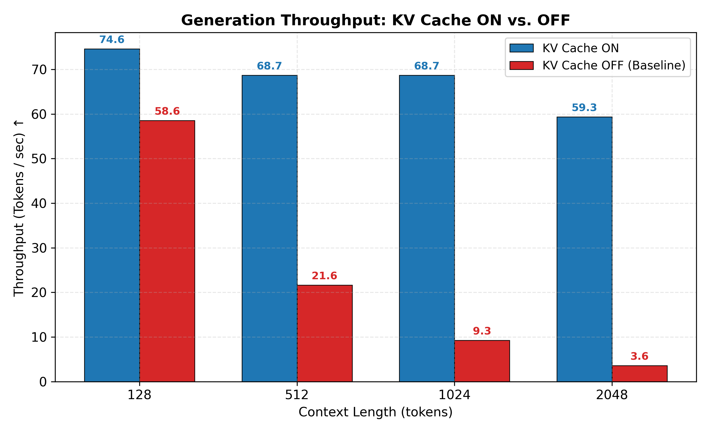
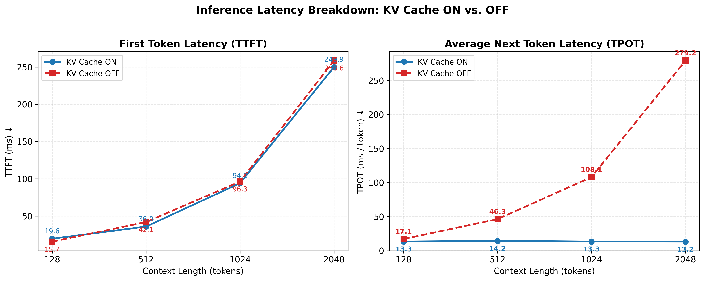
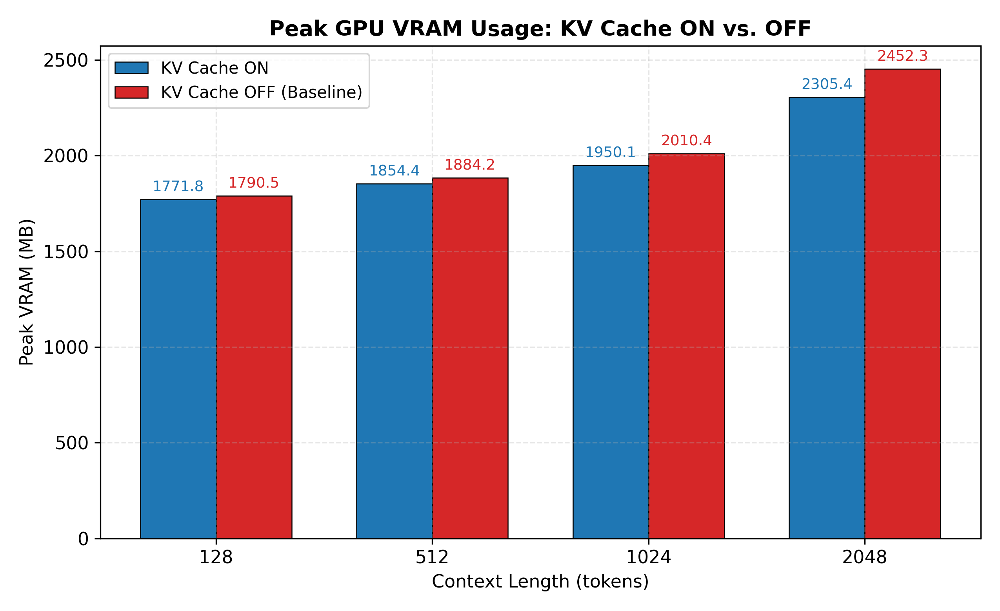

# Capstone Project: Building, Optimizing, and Aligning a 109.5M LLM from Scratch (Track B: Alignment & Safety)

Dự án xây dựng hoàn chỉnh một Mô hình Ngôn ngữ Lớn (LLM) quy mô **109.5M tham số** (tương đương GPT-2 Small) từ con số 0 bằng PyTorch thuần — bao gồm Tokenizer BPE 32k, kiến trúc Transformer hiện đại (RMSNorm, RoPE, SwiGLU, Weight Tying), Pre-training trên Kaggle Dual T4 GPUs, Post-training (**Full Fine-Tuning**, **LoRA + Embedding SFT**, **DPO Alignment**), tối ưu suy luận **Static KV Cache**, hệ thống lọc an toàn **Input/Output Guardrails 2 tầng**, **LLM-as-a-Judge**, và giao diện **Gradio Demo**.

---

## 1. Kiến trúc Mô hình & Pipeline Kỹ thuật

### Kiến trúc 109.5M Transformer (`model/transformer.py`)
- **Tổng số tham số (Weight-Tied)**: `109,529,856` (~109.5M)
- **Tokenizer**: Byte-Pair Encoding (BPE) `vocab_size = 32,000`, `pre_tokenizers.Sequence([Whitespace(), Digits(individual_digits=True)])`
- **Hidden / Layers / Heads**: `d_model = 768`, `n_layers = 12`, `n_heads = 12` (`head_dim = 64`)
- **Feed-Forward**: SwiGLU (`d_ff = 2048`)
- **Normalization & Positional Encoding**: Pre-RMSNorm (`eps = 1e-6`) & Rotary Position Embedding (RoPE, hỗ trợ mở rộng động tới `>= 2200` vị trí)
- **Inference Optimization**: Static Pre-allocated `KVCache` (`inference/kv_cache.py`), Top-p (`0.9`), Repetition Penalty (`1.2`)

### Cấu trúc thư mục chính
```text
capstone-llm/
├── model/              # rmsnorm.py, rope.py, attention.py, swiglu.py, transformer.py, lora.py
├── tokenizer/          # train_tokenizer.py (BPE 32k trên TinyStories + Alpaca + GSM8K)
├── training/           # dataset.py, dpo_loss.py, train_pretrain.py, train_sft.py, train_dpo.py
├── inference/          # kv_cache.py, engine.py, guardrails.py
├── safety/             # guardrails.py (Input/Output Guardrails 2 tầng + đo độ trễ ms)
├── eval/               # evaluate.py, profile_kv_cache.py, eval_guardrails.py, llm_judge.py
├── day2_reports/       # Toàn bộ kết quả thực nghiệm Kaggle, biểu đồ 300 DPI & error_analysis.md
├── tests/              # 17 unit tests (test_week1.py, test_posttrain.py)
├── app.py              # Giao diện Gradio 6 Demo (kèm Telemetry Guardrails & Tokens/s)
└── run_all_kaggle.py   # Script tự động chạy toàn bộ pipeline trên Kaggle
```

---

## 2. Hướng dẫn Cài đặt & Chạy Tái lập (One-Click Run)

### Cài đặt môi trường
```bash
python -m venv .venv
source .venv/bin/activate
pip install torch tokenizers datasets gradio matplotlib pytest kaggle
```

### Chạy kiểm thử đơn vị (Unit Tests)
```bash
pytest tests/ -v
```

### Chạy toàn bộ Pipeline trên Kaggle (All-in-One)
```bash
python run_all_kaggle.py --batch_size 4 --grad_accum 16 --pretrain_steps 5000 --sft_epochs 3 --dpo_steps 1000
```

### Chạy từng bước độc lập (Training, Profiling, Evaluation & Demo)
1. **Huấn luyện Tokenizer 32k & Pre-training 109.5M**:
   ```bash
   python tokenizer/train_tokenizer.py
   python training/train_pretrain.py --batch_size 4 --grad_accum 16 --max_steps 5000
   ```
2. **Supervised Fine-Tuning (So sánh LoRA r=32 + Embedding vs. Full Fine-Tuning)**:
   ```bash
   # LoRA (r=32, alpha=64) + mở khóa Embedding/LM Head
   python training/train_sft.py --epochs 3 --lr 2e-4

   # Full Fine-Tuning (100% tham số, Cosine Annealing LR)
   python training/train_sft.py --full_ft --epochs 3 --lr 2e-4
   ```
3. **Direct Preference Optimization (DPO Alignment, $\beta = 0.1$)**:
   ```bash
   python training/train_dpo.py --max_steps 1000 --beta 0.1 --batch_size 1 --grad_accum 64
   ```
4. **Đánh giá Định lượng Lõi (Validation PPL, Math Pass@1, Safety Refusal + Error Samples)**:
   ```bash
   python eval/evaluate.py --save_samples --out_dir day2_reports/eval_core
   ```
5. **Benchmark KV Cache (L ∈ {128, 512, 1024, 2048}) & Xuất Biểu đồ 300 DPI**:
   ```bash
   python eval/profile_kv_cache.py --out_dir day2_reports/kv_cache
   ```
6. **Đánh giá Input/Output Guardrails (30 Harmful + 30 Benign Prompts)**:
   ```bash
   python eval/eval_guardrails.py --out_dir day2_reports/guardrails
   ```
7. **Đánh giá LLM-as-a-Judge (Pairwise + A/B Position Swap)**:
   ```bash
   # Bước 1: Sinh câu trả lời trên GPU
   python eval/llm_judge.py --generate_only --out_dir day2_reports/llm_judge

   # Bước 2: Chấm điểm với Gemini (>= 2.5 tự động dò), OpenAI hoặc Anthropic
   export GEMINI_API_KEY="YOUR_KEY"
   python eval/llm_judge.py --judge --out_dir day2_reports/llm_judge
   ```
8. **Khởi chạy Gradio Demo (hỗ trợ tự động tìm checkpoint ở `checkpoints/`, `day2_reports/` hoặc `--ckpt_dir`)**:
   ```bash
   python app.py --port 7860
   ```

---

## 3. Kết quả Thực nghiệm Chính thức (Kaggle GPU T4)

### 3.1. Đánh giá Định lượng Cốt lõi (`day2_reports/eval_core/eval_results.md`)

| Model Variant | Validation PPL (↓) | Math Pass@1 (%) (↑) | Safety Refusal Rate (%) (↑) |
|---|---:|---:|---:|
| Base (100M) | **2.84** | 0.0 | 100.0 |
| SFT (Full Fine-Tuning) | 3.19 | 0.0 | 100.0 |
| SFT (Instruct + Math) | 3.19 | 0.0 | 100.0 |
| DPO (Aligned + Safe — Step 200) | 3.24 | 0.0 | 100.0 |

---

### 3.2. Benchmark KV Cache: ON vs. OFF (`day2_reports/kv_cache/kv_cache_profile.md`)

Đo đạc trên GPU CUDA (`gen_tokens = 64`, có `torch.cuda.synchronize()` sau warm-up):

| Context Length (L) | Mode | Throughput (tok/s) ↑ | TTFT (ms) ↓ | TPOT (ms/tok) ↓ | Peak VRAM (MB) | Speedup |
|---:|---|---:|---:|---:|---:|---:|
| 128 | **KV Cache ON** | **74.58** | 19.63 | **13.31** | **1771.81** | **1.27x** |
| 128 | KV Cache OFF | 58.57 | 15.70 | 17.09 | 1790.50 | 1.00x |
| 512 | **KV Cache ON** | **68.71** | **36.01** | **14.21** | **1854.44** | **3.18x** |
| 512 | KV Cache OFF | 21.63 | 42.12 | 46.29 | 1884.20 | 1.00x |
| 1024 | **KV Cache ON** | **68.67** | **94.18** | **13.30** | **1950.07** | **7.41x** |
| 1024 | KV Cache OFF | 9.27 | 96.33 | 108.06 | 2010.40 | 1.00x |
| 2048 | **KV Cache ON** | **59.33** | **249.95** | **13.15** | **2305.45** | **16.53x** |
| 2048 | KV Cache OFF | 3.59 | 258.63 | 279.21 | 2452.28 | 1.00x |

#### Biểu đồ trực quan (300 DPI)
- **Throughput**: 
- **Latency (TTFT & TPOT)**: 
- **Peak VRAM**: 

---

### 3.3. Đánh giá Input/Output Guardrails (`day2_reports/guardrails/guardrails_eval.md`)

Kiểm thử trên 30 prompt độc hại (Prompt Injection, DAN Jailbreak, Malware/Weapons) và 30 prompt vô hại:

| Configuration | Attack Block Rate (30 Harmful) ↑ | False Positive Rate (30 Benign) ↓ | Avg Guardrail Latency (ms) |
|---|---|---|---|
| DPO (Step 200) không Guardrails | 16.7% (5/30) | 3.3% (1/30) | 0.000 |
| **DPO (Step 200) + Input/Output Guardrails** | **100.0% (30/30)** | **3.3% (1/30)** | **In: 0.024 / Out: 0.066** |

---

### 3.4. Đánh giá LLM-as-a-Judge (`day2_reports/llm_judge/llm_judge_results.md`)

Chấm cặp đối kháng 30 prompt đa lĩnh vực (kèm đảo vị trí A/B chống position bias, sử dụng trọng tài Gemini 3.5/3.1 Flash Lite):

| Pair (Model A vs Model B) | Win A (%) | Tie (%) | Win B (%) | Avg Score A (1-10) | Avg Score B (1-10) |
|---|---:|---:|---:|---:|---:|
| **SFT (LoRA+Embed) vs Base** | **23.3%** | 76.7% | 0.0% | **2.28** | 1.43 |
| **SFT (Full FT) vs SFT (LoRA+Embed)** | **10.0%** | 83.3% | 6.7% | **2.82** | 2.72 |
| **DPO (Step 200) vs SFT (LoRA+Embed)** | **16.7%** | 70.0% | 13.3% | **2.60** | 1.33 |

---

### 3.5. Phân tích Lỗi (Error Analysis)
Xem báo cáo phân tích 6 trường hợp thất bại điển hình kèm mẫu dữ liệu gốc tại [day2_reports/error_analysis.md](day2_reports/error_analysis.md).
